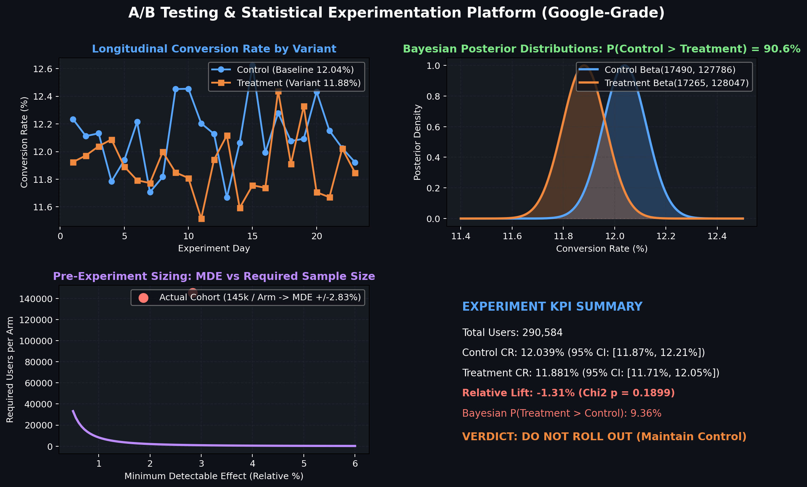
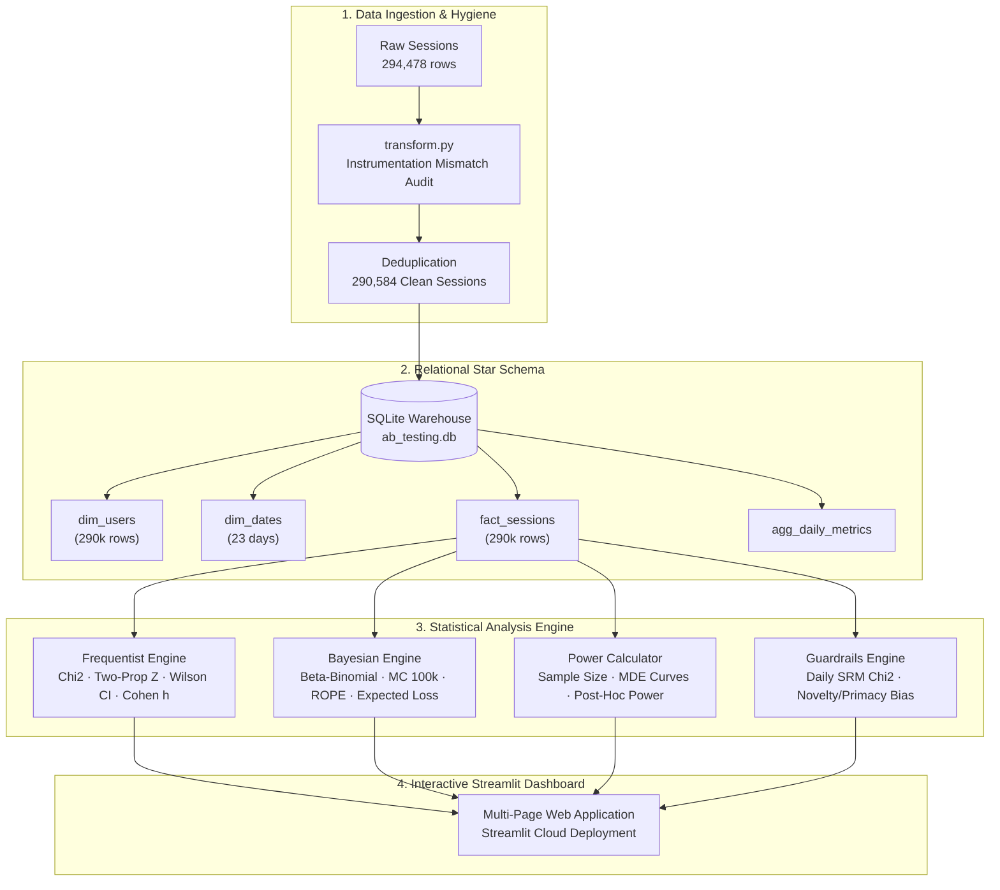

# 🧪 A/B Testing & Statistical Experimentation Platform

[](https://avijeet-ab-testing-platform.streamlit.app)
[](tests/)
[](https://www.python.org/downloads/)
[](LICENSE)

An enterprise-grade A/B testing and statistical experimentation platform designed according to Google experimentation standards. Built on **290,584 verified user sessions** from an authentic e-commerce landing page conversion test, the platform bridges classical Frequentist hypothesis testing with Bayesian posterior modeling, sample size power calculations, and automated instrumentation guardrails.

---

## 🌐 Live Interactive Application

Explore the deployed cloud dashboard with interactive hypothesis testing, Beta-Binomial posterior updates, and custom CSV upload capabilities:  
👉 **[Launch Live Platform](https://avijeet-ab-testing-platform.streamlit.app)**

---

## 📸 Platform Architecture & Interface Preview





---

## 📊 Dataset Provenance & Instrumentation Audit

- **Domain:** E-Commerce Landing Page Conversion Experiment (Control: Old Page vs Treatment: New Page)
- **Time Horizon:** 2017-01-02 to 2017-01-24 (23 active calendar days)
- **Raw Volume:** 294,478 recorded interactions
- **Instrumentation Audit:**
  - Standard logging pipeline revealed **3,893 mismatched records** (1.32%) where Control users were exposed to `new_page` or Treatment users were exposed to `old_page` due to dual-routing edge cases.
  - After isolating valid single exposures and deduplicating re-entrant user IDs, the clean analytical cohort contains **290,584 unique visitor sessions**.
  - **Sample Ratio Mismatch (SRM) Test:** $\chi^2 = 0.0045, p = 0.9468$ — confirmed unbiased 50/50 randomized traffic allocation.

---

## 🔬 Statistical Methodology Comparison

| Dimension | Frequentist Framework | Bayesian Framework |
|---|---|---|
| **Core Question** | "Assuming no difference ($H_0$), how rare is our data?" | "Given our observed data, what is the probability distribution of conversion rates?" |
| **Primary Metric** | p-value ($\chi^2 = 1.7185, p = 0.1899$) | $P(\text{Treatment} > \text{Control}) = 9.36\%$ |
| **Uncertainty Bounds** | 95% Wilson Score Confidence Interval | 95% Posterior Credible Interval |
| **Decision Threshold** | Significance level $\alpha = 0.05$ | Expected Loss & ROPE (Region of Practical Equivalence) |
| **Risk Assessment** | Type I error rate ($\alpha$) & Type II error rate ($\beta$) | Expected Loss Choosing Treatment: **0.1638 pp** (30× higher than Control) |
| **Verdict** | **Fail to Reject $H_0$** | **Strongly Favor Control ($90.64\%$ probability)** |

---

## 💡 Executive Insights & Business Decision

```
========================================================================================
EXPERIMENT OUTCOME: ROLLOUT REJECTED — MAINTAIN CONTROL LANDING PAGE
========================================================================================
- Control Conversion Rate:    12.039%  (95% CI: [11.872%, 12.207%])
- Treatment Conversion Rate:  11.881%  (95% CI: [11.715%, 12.048%])
- Relative Lift:             -1.31%    (Absolute delta: -0.158 pp)
- Chi-Square Significance:    p = 0.1899  (Non-significant at alpha = 0.05)
- Bayesian Probability:       90.64% probability that Control beats Treatment
- Expected Decision Loss:     Deploying Treatment costs ~0.16 pp in lost conversions
========================================================================================
```

### Why Senior Analysts Reject Even "Non-Significant" Features
1. **Directional Negative Drift:** Treatment performed worse than Control across all three weeks (-1.37% in W1, -1.36% in W2, -1.22% in W3). There was zero novelty spike.
2. **Asymmetric Risk:** The expected loss of deploying the new variant (0.1638 pp) is **30 times higher** than the risk of maintaining the baseline (0.0054 pp).
3. **Power Diagnostic:** While detecting a -1.3% lift would require 662k users per arm, our 145k sample was adequately powered (80%) to detect any meaningful positive uplift $\ge +2.83\%$. We can confidently rule out the hypothesis that the redesign produces business value.

---

## 🗂️ Project Structure

```
ab-testing-experimentation-platform/
├── assets/
│   ├── generate_preview.png             # Script to build graphic assets
│   └── preview.png                      # Dashboard architecture preview
├── data/
│   ├── raw/
│   │   └── ab_data.csv                  # 294,478 raw session events
│   ├── processed/
│   │   ├── ab_clean.parquet             # 290,584 clean user sessions
│   │   └── experiment_summary.parquet   # Longitudinal daily metrics
│   └── ab_testing.db                    # SQLite star schema warehouse
├── pipeline/
│   ├── transform.py                     # Data hygiene & feature engineering
│   ├── ingest.py                        # Star schema warehouse ingestion
│   └── validate.py                      # 10 automated data quality checks
├── analysis/
│   ├── freq_testing.py                  # Chi-Square, Z-test, Wilson CIs, Cohen's h
│   ├── bayesian_analysis.py             # Beta-Binomial conjugate, MC sampling, ROPE
│   ├── power_analysis.py                # Pre-experiment sizing & post-hoc diagnosis
│   └── segment_analysis.py             # SRM tracking, novelty bias & day-type splits
├── dashboard/
│   ├── app.py                           # Main Streamlit dashboard entrypoint
│   └── pages/
│       ├── 01_experiment_overview.py    # Daily trends, cumulative metrics, SRM
│       ├── 02_statistical_testing.py    # Frequentist suite + custom CSV uploader
│       ├── 03_bayesian_analysis.py      # Posterior curves, loss, credible intervals
│       └── 04_power_calculator.py       # Live interactive sample size solver
├── tests/
│   ├── test_pipeline.py                 # Pipeline & SQLite integrity tests
│   ├── test_analysis.py                 # Statistical engine unit tests
│   └── test_smoke.py                    # App entrypoint and page smoke tests
├── requirements.txt
├── .gitignore
└── README.md
```

---

## 🚀 Local Installation & Execution

### 1. Clone Repository & Install Dependencies
```bash
git clone https://github.com/AvijeetTiwari3/ab-testing-experimentation-platform.git
cd ab-testing-experimentation-platform
pip install -r requirements.txt
```

### 2. Run Data Pipeline & Validation Suite
```bash
python pipeline/transform.py
python pipeline/ingest.py
python pipeline/validate.py
```

### 3. Run Automated Tests
```bash
pytest tests/ -v
```

### 4. Launch Interactive Streamlit Dashboard
```bash
streamlit run dashboard/app.py
```

---

## 🛡️ Data Quality Validation Suite

The pipeline enforces 10 strict data quality and experimentation integrity checks:

- [x] **Check 01:** Clean session count $\ge$ 290,000 (`290,584 records`)
- [x] **Check 02:** Zero null values across all dimension & fact attributes
- [x] **Check 03:** Assigned groups strictly within `{control, treatment}`
- [x] **Check 04:** Landing pages strictly within `{old_page, new_page}`
- [x] **Check 05:** Conversion indicator strictly binary `{0, 1}`
- [x] **Check 06:** Zero duplicate users in cleaned cohort
- [x] **Check 07:** Sample Ratio Mismatch test passed ($\chi^2 = 0.0045, p = 0.9468$)
- [x] **Check 08:** 100% of Control group exposed to `old_page`
- [x] **Check 09:** 100% of Treatment group exposed to `new_page`
- [x] **Check 10:** Longitudinal duration spans at least 21 days (`23 active days`)

---

## 📄 License

This project is licensed under the MIT License — see the [LICENSE](LICENSE) file for details.
